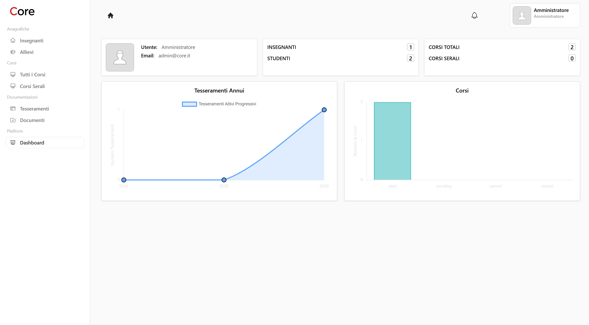
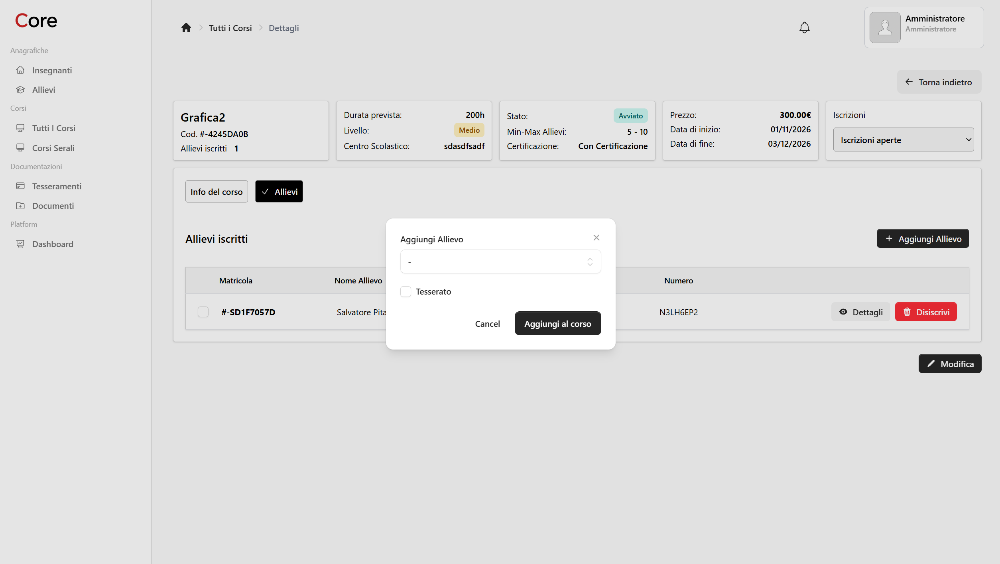

# Core

Core è una piattaforma web per la gestione di corsi di formazione e delle persone
che vi partecipano. Offre un'area amministrativa e bacheche dedicate ad
amministratori, istruttori e allievi.

## Anteprima




## Funzionalità

- **Amministrazione:** dashboard con riepiloghi e grafici; gestione di istruttori,
  allievi, corsi e corsi serali.
- **Gestione didattica:** associazione di corsi, materie, istruttori e allievi;
  consultazione dei tesserini e dei documenti.
- **Aree personali:** istruttori e allievi possono consultare le informazioni
  pertinenti al proprio profilo, come corsi e materie.
- **Iscrizione ai corsi:** modulo di iscrizione accessibile tramite link con
  token.
- **Account:** autenticazione, gestione del profilo e della password e
  autenticazione a due fattori.
- **Ruoli:** accesso alle aree applicative in base al ruolo di amministratore,
  istruttore o allievo.

## Tecnologie

- PHP 8.2 o superiore e Laravel 12
- Livewire, Volt e Flux
- MySQL 8.4 con Docker Compose oppure SQLite per lo sviluppo locale
- Vite e Tailwind CSS
- Pest per i test

## Requisiti

- PHP 8.2+ con le estensioni richieste da Laravel
- Composer
- Node.js e npm
- SQLite per la configurazione locale predefinita
- In alternativa, Docker Compose per l'ambiente basato su MySQL

## Installazione locale

Dalla directory del progetto:

```bash
composer install
cp .env.example .env
touch database/database.sqlite
php artisan key:generate
php artisan migrate
npm install
npm run build
```

La configurazione d'esempio utilizza SQLite. Se si sceglie un database diverso,
aggiornare le relative variabili in `.env` prima di eseguire le migrazioni.

Per avviare il server:

```bash
php artisan serve
```

Aprire quindi l'indirizzo mostrato da Artisan (normalmente
`http://127.0.0.1:8000`). Durante lo sviluppo è possibile avviare insieme server,
worker della coda, log e Vite con:

```bash
composer run dev
```

## Docker

Il file `compose.yaml` definisce i servizi Laravel Sail, MySQL 8.4 e phpMyAdmin.
Prima dell'avvio, configurare in `.env` la connessione MySQL (`DB_CONNECTION`,
`DB_HOST`, `DB_PORT`, `DB_DATABASE`, `DB_USERNAME` e `DB_PASSWORD`) e le variabili
richieste da Sail.

## Test

Eseguire la suite con:

```bash
php artisan test
```
